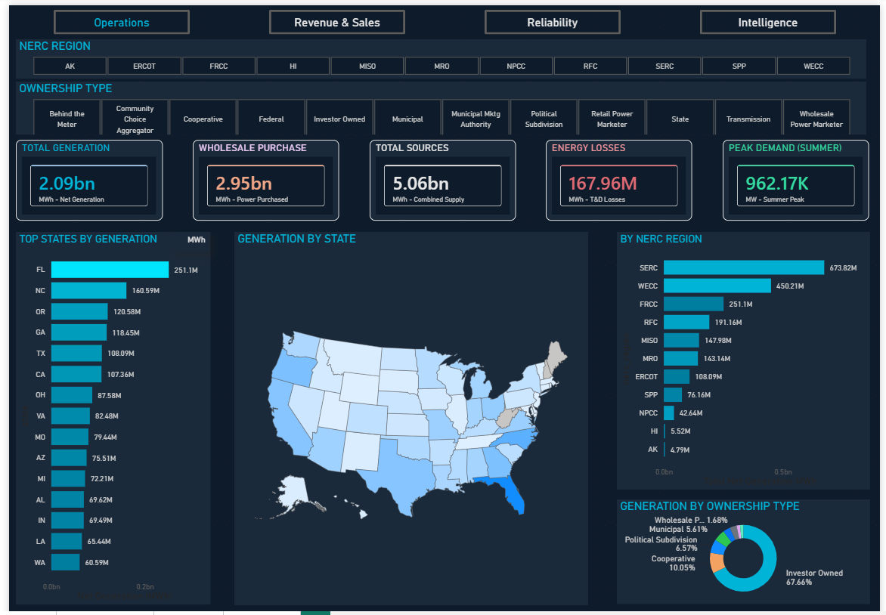
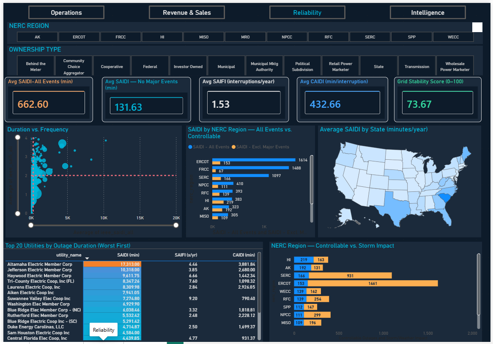
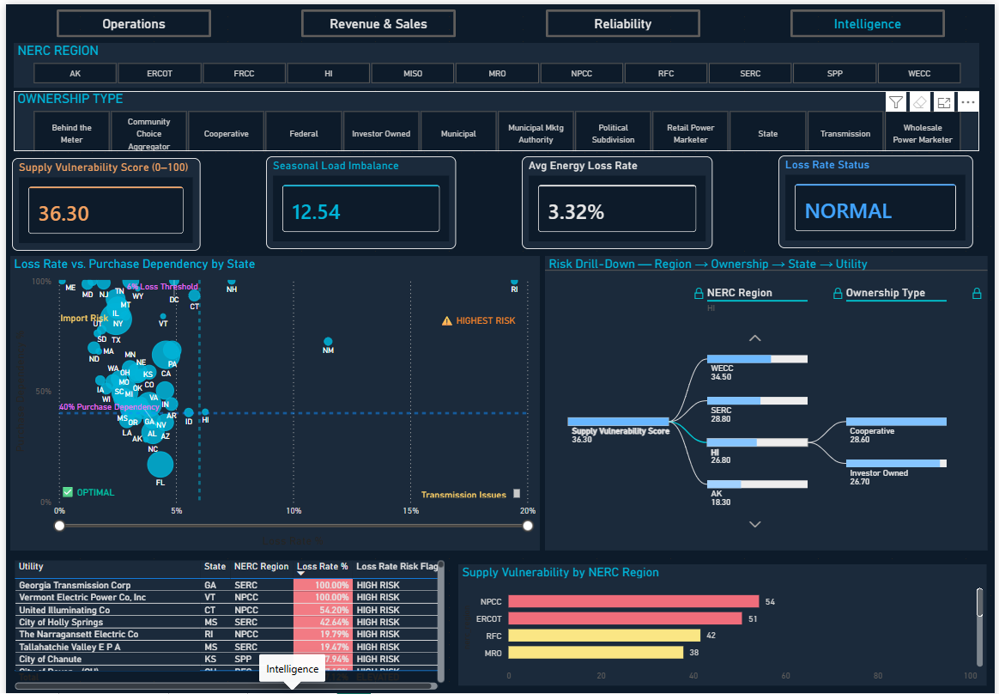

# U.S. Electrical Grid — Intelligence & Operations Dashboard

A four-page Power BI dashboard on 2024 U.S. electric utility data from the U.S. Energy Information Administration (EIA): generation and supply, revenue and sales, outage reliability, and supply-risk scoring for about 5,150 utility records across the 50 states and DC.



## Business question

Where is the U.S. grid most exposed: to purchase dependency, energy losses, storm outages or revenue concentration? And which regions, ownership types and utilities drive that exposure?

## Architecture

```
EIA Form 861 + operational CSVs  →  SQL Server Express (EnergyWorkforce_DB)  →  Power BI star schema
                                         fact_operational, fact_sales              3 facts · 3 dimensions · 45 DAX measures
EIA-861 reliability CSV  ─────────────────────────────────────────────→  fact_reliability (Power Query)
```

- **Facts:** `fact_operational`, `fact_sales`, `fact_reliability`
- **Dimensions:** `dim_state` (state → primary NERC region), `dim_ownership_type`, `dim_nerc_region`
- **Slicers:** NERC Region and Ownership Type filter every card and chart on all four pages
- Saved as a Power BI Project (`.pbip`), so the report and model are plain-text files that work with Git.

## Pages

| Page | What it shows |
|---|---|
| **Operations** | Net generation, wholesale purchases, total supply, losses, summer peak, and generation by state, region and ownership |
| **Revenue & Sales** | Revenue, revenue per MWh and per customer, sector mix, and revenue by ownership and state |
| **Reliability** | Customer-weighted SAIDI, SAIFI and CAIDI, storm vs. controllable outages, and the 20 worst utilities |
| **Intelligence** | Supply Vulnerability Score, loss-rate risk, a state risk scatter, and a region → ownership → state → utility drill-down |

## Screenshots

| Revenue & Sales | Reliability | Intelligence |
|---|---|---|
|  |  |  |

## Key findings (2024)

- **58% of U.S. utility supply is bought, not generated:** 2.95B MWh purchased vs. 2.09B MWh generated. Purchase dependency drives a national Supply Vulnerability Score of 36.3 / 100.
- **Storms caused about 80% of outage time.** The average customer lost 662.6 minutes (about 11 hours), but only 131.6 minutes excluding major event days. ERCOT and FRCC saw the largest storm impact.
- **Cooperatives have the weakest controllable reliability:** 188 minutes excluding major events, vs. 128 for investor-owned and 90 for municipal utilities.
- **$514.4B in retail revenue, $112.59 per MWh.** Price ranges from $64 per MWh in Ohio to $380 in Hawaii. Residential customers provide 47.5% of revenue.
- **NPCC (New England and New York) is the most import-dependent region** (vulnerability score 54.3). Rhode Island, New Mexico, New Hampshire and Hawaii sit in the high-loss, high-dependency corner.

Full write-up: [`ElectricalGrid_DataReport_Findings.pdf`](ElectricalGrid_DataReport_Findings.pdf)

## Data-quality fix

The first version of the reliability KPIs was wrong. The SQL load split quoted values that contain commas (`"Northern Lights, Inc"`, `"39,641"`) into extra columns. That shifted 136 rows and wiped customer counts in 968 of 971 rows, so the "national" reliability figures were really based on 3 small co-ops.

I found it by profiling the model's data, then rebuilt `fact_reliability` in Power Query with proper CSV quoting. After the fix, national SAIDI moved from 119 to 663 minutes, which matches EIA's reported ~11 hours of outage per customer in 2024.

## Data sources

- EIA Form 861 (2024): sales to ultimate customers, reliability, and utility data. [eia.gov/electricity/data/eia861](https://www.eia.gov/electricity/data/eia861/)
- EIA-930 hourly grid files: not included (over GitHub's 100 MB limit, and not used in the 2024 KPIs).

## How to open

1. Install Power BI Desktop.
2. Open `Electrical Grid USA.pbip`.
3. To refresh, point the SQL source (`DANIEL_O_PC\SQLEXPRESS`) and the reliability CSV path to your own locations in Power Query.

---
Built with Power BI Desktop · SQL Server Express · DAX · Power Query — by Daniel O.
